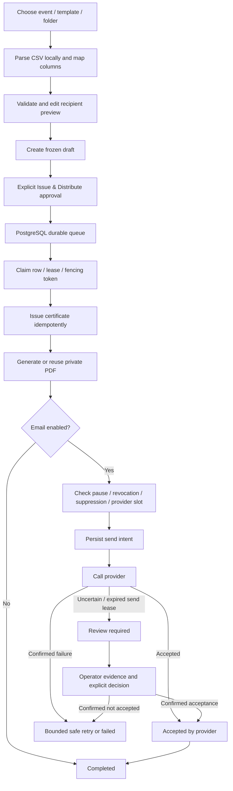

# Issuance flow

Each safe stage completion requires its current unexpired lease and fencing token. An expired processing lease may be reclaimed. An expired email send intent is uncertain and held for review. PDF paths and checksums let retries reuse the same artifact. Database transactions preserve stage transitions, certificate identity, and audit history.

Batch states are `draft`, `queued`, `running`, `paused`, `completed`, and `needs_attention`. Item stages are `issue`, `pdf`, `email`, and `done`; states distinguish `queued`, `running`, `retry`, `completed`, `failed`, `review_required`, and `suppressed`. A paused batch stops new claims while in-flight safe work may finish. Resume preserves completed and ambiguous outcomes. Retry affects eligible failed work only.

The browser polls persisted batch snapshots and displays actual summary counts. Closing the browser after approval does not stop processing. Reports escape CSV cells and protect against spreadsheet formulas. Names and email addresses may appear in admin reports; store exported files appropriately.

SMTP acceptance is not delivered status. A supported signed delivery-event endpoint can record delivered or bounced outcomes with replay protection; Gmail has no such webhook here. Certificate validity remains independent of processing and email outcomes. Revocation blocks future distribution and checked downloads without rewriting historical attempts.

The migration flow is: offline plan check → explicit migration flag → session advisory lock → checksum verification → canonical schema only if fresh → ordered additive migrations with atomic history writes. A failed file rolls back its own transaction; earlier successful migrations remain recorded.
